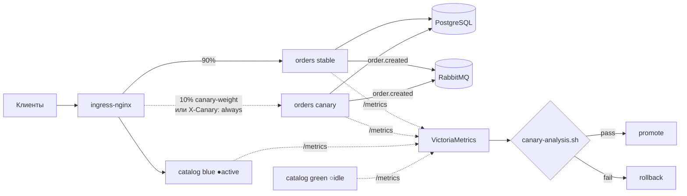
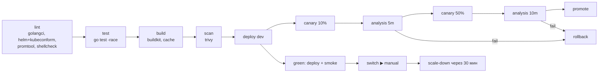

# shop-platform

[](https://github.com/GiitEnjoyer/shop-platform/actions/workflows/ci.yml)

Микросервисы интернет-магазина и полный цикл их доставки в Kubernetes: сборка, сканирование, деплой без простоя через **Canary** (ingress-nginx, автоматический анализ метрик и откат) и **Blue-Green**, SLO с multi-window burn-rate алертами, нагрузочное тестирование.

> Демонстрационный проект. Воспроизводит практики, которые я применяю на коммерческих проектах (они под NDA). Код написан с нуля и не содержит кода и данных заказчиков.

Инфраструктура, на которой это работает (Terraform/Terragrunt, кластер, VictoriaMetrics, Vault), — в репозитории [platform-infra](https://github.com/GiitEnjoyer/platform-infra).

## Что демонстрирует проект

| Практика | Где смотреть |
|---|---|
| Canary-релизы с автоматическим анализом и откатом | `.gitlab-ci.yml` (jobs `canary:*`), `scripts/canary-analysis.sh` + тесты |
| Blue-Green с прогревом, smoke-тестом и мгновенным откатом | `scripts/blue-green.sh`, e2e на kind: `scripts/e2e-kind.sh` |
| Универсальный Helm-чарт: HPA, PDB, zone spread, NetworkPolicy, Vault Agent, миграции как hook | `deploy/helm/microservice` |
| SLO 99,9 % и burn-rate алерты (Google SRE Workbook) с unit-тестами | `observability/rules` |
| RED-метрики, request ID, graceful shutdown, readiness ≠ liveness | `internal/httpx` |
| Безопасные образы: distroless, non-root, read-only rootfs, Trivy в CI | `Dockerfile`, job `scan` |
| Нагрузочный профиль с порогами = SLO | `loadtest/k6-shop.js` |

## Архитектура



- **catalog** — каталог товаров, read-heavy, данные в памяти; релизится Blue-Green.
- **orders** — приём заказов: PostgreSQL (идемпотентность по `Idempotency-Key`), событие `order.created` в RabbitMQ с publisher confirms; релизится через Canary.

Почему разные стратегии — [ADR-0001](docs/adr/0001-canary-vs-blue-green.md).

## Пайплайн



Гейты анализа canary (`scripts/canary-analysis.sh`):

1. доля 5xx у canary ≤ max(1 %, доля у stable × 2) — сбой зависимости, бьющий по обеим версиям, не блокирует релиз;
2. p99 canary ≤ p99 stable × 1,5 и ≤ 500 мс;
3. canary обработал ≥ 100 запросов — без трафика вердикт не выносится.

## Локальный запуск

```bash
make up          # сервисы + Postgres + RabbitMQ + Prometheus + Grafana
make loadtest    # k6, профиль 85% чтение / 15% заказы
make canary-demo # orders с 20% ошибок -> срабатывают SLO-алерты
make test        # go test -race, promtool test, pytest
make e2e         # Blue-Green сценарий на kind (v1 -> v2 -> switch -> rollback)
```

Grafana: http://localhost:3000 → дашборд «Shop / Service SLO and canary».

```bash
curl localhost:8080/api/v1/products?category=electronics
curl -X POST localhost:8081/api/v1/orders -H 'Idempotency-Key: 42' \
  -d '{"customer_id":"c1","items":[{"product_id":"p-1001","quantity":1,"price_rub":89990}]}'
```

## Структура

```
cmd/                    точки входа сервисов
internal/httpx          middleware (request ID, RED-метрики, recovery), probes, graceful shutdown
internal/chaos          инъекция ошибок/задержек для демонстрации отката canary
services/{catalog,orders}  бизнес-логика + тесты
deploy/helm/microservice   универсальный чарт
deploy/helm/values/        значения по сервисам и окружениям
deploy/compose/            локальный стенд
observability/             SLO-правила с тестами, дашборды
scripts/                   canary-analysis, blue-green, e2e
docs/                      ADR и runbooks
```

## Лицензия

MIT
